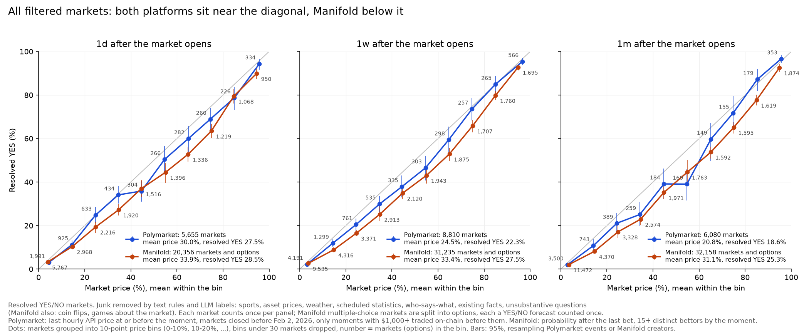
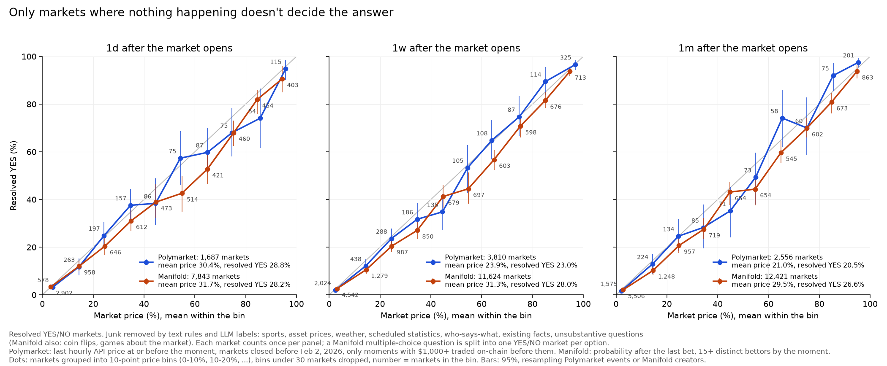

# Are Polymarket and Manifold well calibrated on non-garbage markets?

**Short answer: mostly, apart from one predictable bias.** Both platforms overprice "something happens": when a question resolves NO if nothing new happens ("Will X happen by June?"), YES is too expensive. More on the bias in [the other post](TODO-link).

- **Polymarket is close to calibrated.** One week after a market opens, prices average 24.4% and 22.4% of markets resolve YES (11,881 markets).
- **Manifold overprices YES by about 8 points** (40.0% priced, 32.3% resolved YES; 9,762 markets). Almost all of this gap comes from the bias above.
- **On questions where nothing happening doesn't decide the answer**, such as elections and awards, both platforms are close to the diagonal: Polymarket is off by under 1 point, Manifold by about 4.

*Every filtered market on both platforms (filters below). We take each market's price 1 day, 1 week and 1 month after it opens. We sort the markets into price bins (0–10%, 10–20%, …). For each bin, the x-axis shows the mean price of its markets and the y-axis shows the share that resolved YES. If prices mean what they say, the dots sit on the diagonal. The number next to each dot is how many markets are in the bin. Bars are bootstrap 95% CI intervals.*

*The same plot, but only for markets where neither answer wins if nothing happens: "Will X win the election?" rather than "Will X happen by June?". Haiku 5.5 decided this from the question text alone, without seeing prices or outcomes. These are the markets the bias shouldn't touch.*

## What I did

About 95% of Polymarket markets are crypto and other asset prices ("Bitcoin up or down?"), sports questions that mirror ordinary betting (who wins A vs B, with what score) and weather forecasts. On top of that come things like "how many tweets will Elon post next week". I've seen a couple of papers that check how calibrated the markets are, but they never filtered the junk out. I wondered what happens if you seriously try to look only at reasonable markets.

First, a regex filter removed sports, asset-price and weather markets. Then Haiku 5.5 medium answered 25 yes/no questions about the text of each remaining market. The questions target the biggest kinds of junk Opus 5.5 high found on a 400-per-platform-market sample of the markets that got through the regex: coin flips, games about the market itself. We keep only markets whose answers flag none of these. Separately Haiku assigned a numerical score of how substantive a score was and we only kept the markets above a hand picked threshold. Interestingly, the LLM filter did not affect the calibration of the markets / end results at all. 

We also dropped thinly traded moments. On Polymarket, a market counts at a given moment only if $1,000 had already been traded on it. On Manifold, at least 15 different people must have bet on it by then.

Another "junk market" caveat is weighting by events. An "event" is one question with many options split into many yes/no markets. For example, "Who will be the next US president?" becomes one market per candidate. Weighting per market makes the numbers less noisy, weighting per event makes few many-option markets not dominate the analysis. Thankfully, both analyses return basically the same result.  The headline plots count every market separately. The plots where each event gets a weight of one are below. 

Finally, series. Some questions repeat with only a number or date changed, such as weekly tweet counts or "ceasefire by June / July / August". These could have needed a rule, such as "count at most N events per series". Turned out, we didn't need one: after the regex+LLM sieve, the few remaining long series carried little weight, and capping each series at 5 events barely changed anything.

## Methodology for nerds and especially LLMs, Claude-generated

I apologise for having this part auto-generated, but I'm pretty burnt out from what was supposed to be a one-weekend project.

### Question

Do the prices of Polymarket and Manifold match how often things actually happen, on questions about the world? Mass-produced markets like sports, asset prices, weather and coin flips are excluded. Studies that pool all markets are dominated by these: Dickerson et al. (PNAS 2026) and Reichenbach & Walther (SSRN 2026).

### Data

- **Polymarket:** we used Polymarket's own APIs (Gamma for market data, CLOB for price history). Dollars traded before each moment come from the Becker on-chain trades dataset, which ends on 2026-02-02. Of about 2.06M Polymarket markets, our regex rules flag 1.12M as sports, 0.75M as asset prices and 0.09M as weather. We remove those and keep resolved Yes/No markets that closed before 2026-02-02 with at least $1,000 of lifetime volume: 36,853 markets.
- **Manifold:** we used Manifold's public API, fetched on 2026-10-30. We kept resolved binary markets with at least 15 bettors and at least 1,000 mana traded over the market's lifetime: 37,680 markets. Of these, 27,752 are labeled as questions about the world. Multiple-choice markets are excluded.

### Which markets count as junk

- **Manifold:** each market got 25 tag questions, answered from the text only. The model never saw prices, outcomes or close dates. Jev, a cheap classification model, labeled every market. Opus 5.5 and GPT 6.1 Terra labeled 1,115 markets by hand, chosen where the labels contradicted each other or at random. A tag counts as yes when Jev puts it at 0.8 or higher. The order is fixed, and the first match wins:
  1. coin flips and other fixed-chance games;
  2. existing facts and estimates;
  3. things that are traded or forecast elsewhere anyway (sports, prices, weather, scheduled statistics, who-says-what);
  4. "not a substantive question about the world" (Jev 0.2 or lower).

  Everything else is "world": the 27,752 markets above. On 100 random world markets, Opus scored 9 as hardly substantive, 5 of them about one streamer.
- **Polymarket:** only the regex filter above. Who-says-what markets and rankings stay in the sample (about 35% of markets, but about 8% of dollars traded). Removing them moves the overall shift from −0.23 to −0.25, and the shift for "nothing happening means NO" from −0.34 to −0.35. Note the asymmetry: Manifold drops who-says-what markets, Polymarket keeps them.

### Forecasts

- **Moments:** 1 day, 1 week and 1 month (30 days) after Polymarket trading starts or after the Manifold market is created. A market counts at a moment only if it was still open then, and each market counts once per panel.
- **Why not "N days before resolution":** the resolution date depends on the outcome. "By date" questions resolve early when YES happens, so "1 week before resolution" is a different calendar moment for YES markets and NO markets. That makes the numbers look better than they are; see the other post. Fixed times after opening don't depend on the outcome.
- **Polymarket price:** the last hourly point of the CLOB price history at or before the moment, at most 3 days old. A market counts only if at least $1,000 had been traded on-chain before the moment. Without this rule, empty order books show fake prices near 50%. We also drop markets in one-winner events whose prices, at that moment, sum to more than 130%.
- **Manifold price:** the probability after the last bet that moved the price, at or before the moment. A market counts only if at least 15 distinct bettors had bet by then.
- **Counts at 1 week:** 22,228 Polymarket markets have a price, and 11,881 of them pass the $1,000 rule. 1,697 Polymarket markets from before 2023 traded on an older system with no on-chain record, so they drop out. On Manifold, 9,762 of 27,748 labeled world markets have 15 bettors by then and are still open.

### "No default side"

Haiku 5.5 (medium effort, one market per call, text only) answered:

> If nothing new happens and the current state of affairs simply continues until the deadline, how does this market resolve? Answer YES, NO, or NONE. Answer NONE when the outcome is decided by a scheduled event, measurement or decision that will happen anyway, such as an election, a vote count or an award.

"No default side" means NONE. When we reran the question on 100 Manifold markets, Haiku gave the same answer on 96. All labels and prompts are in the [repository](https://github.com/nape662/prediction_markets_calibration).

### Statistics

- **Bins:** 10-point price bins. Each dot shows the bin's mean price and the share of its markets that resolved YES. Bins with fewer than 30 markets are hidden.
- **Shift:** a single number added to every price's log-odds so that the group's mean price equals its YES rate. 0 means calibrated. Below 0 means YES is overpriced: at −0.23, a market priced 50% resolves YES about 44% of the time; at −0.51, about 37.5%.
- **95% intervals:** we resample clusters with replacement, 500 times, and take percentiles. A cluster is a Polymarket event, because its markets share one outcome, or a Manifold creator. Separate events in one storyline ("ceasefire by June?", "… by July?") still count as independent, so the intervals are probably somewhat too narrow.
- **Brier score:** mean of (price − outcome)². The baseline always predicts the group's own YES share. It knows that share only after the fact, which flatters it slightly.
- **Log loss:** natural log, with prices clipped to 0.1%–99.9%.
- **AUROC:** the chance that a random market that resolved YES had a higher price than a random market that resolved NO. It measures ranking only and ignores calibration.
- **Balanced accuracy:** predict YES when the price is above 50%. It is the mean of the share of YES markets called correctly and the share of NO markets called correctly.

### Results, 1 week after opening

| | Markets | Mean price → YES rate | Shift (95%) | Brier (baseline) | AUROC | Balanced accuracy |
|---|---|---|---|---|---|---|
| Polymarket, all | 11,881 | 24.4% → 22.4% | −0.23 (−0.28 to −0.17) | 0.087 (0.174) | 0.92 | 0.80 |
| Polymarket, no default side | 6,077 | 23.2% → 22.5% | −0.11 (−0.17 to −0.05) | 0.074 (0.174) | 0.94 | 0.83 |
| Manifold, all world | 9,762 | 40.0% → 32.3% | −0.51 (−0.57 to −0.45) | 0.150 (0.219) | 0.85 | 0.76 |
| Manifold, no default side | 1,529 | 48.1% → 44.2% | −0.23 (−0.35 to −0.11) | 0.169 (0.247) | 0.83 | 0.74 |

The 1-day and 1-month numbers tell the same story; they are in `plots/metrics.csv`. On Polymarket, giving each event a total weight of 1 gives shifts of −0.30 (−0.36 to −0.23) for all markets (5,510 events) and −0.12 (−0.23 to −0.00) for no default side (1,697 events). An earlier run grouped repeating events into series by title, with numbers and dates removed. Series with more than 5 events held 10% of the event weight at 1 week, and capping each series at 5 events cut that to 5%. The cap made no visible difference, so the final plots don't use it.

**Read with care:**
- The two platforms' samples contain different questions, so these numbers don't say which platform forecasts better.
- Manifold numbers probably understate the overpricing. Markets that were still unresolved at the fetch are missing, and the recent markets that have resolved lean YES. If we keep only markets whose stated deadline passed at least 60 days before the fetch, Manifold's overall gap grows from 7.7 to 9.9 points. On Polymarket, the same filter leaves the "nothing happening means NO" shift unchanged at −0.34.
- Manifold's lifetime requirement of 1,000 mana traded uses information from after the moment.

### Reproduce

Code, labels and prompts: https://github.com/nape662/prediction_markets_calibration. `python src/both_platforms.py` draws both plots above and writes `plots/metrics.csv`. It reads the outputs of `polymarket/prices.py` and `manifold/second_pass_analysis.py` (see their docstrings). The raw data is not in the repository because of its size. It comes from the public APIs and the Becker dataset (github.com/Jon-Becker/prediction-market-analysis).
