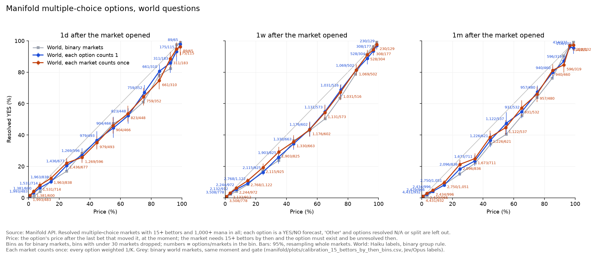
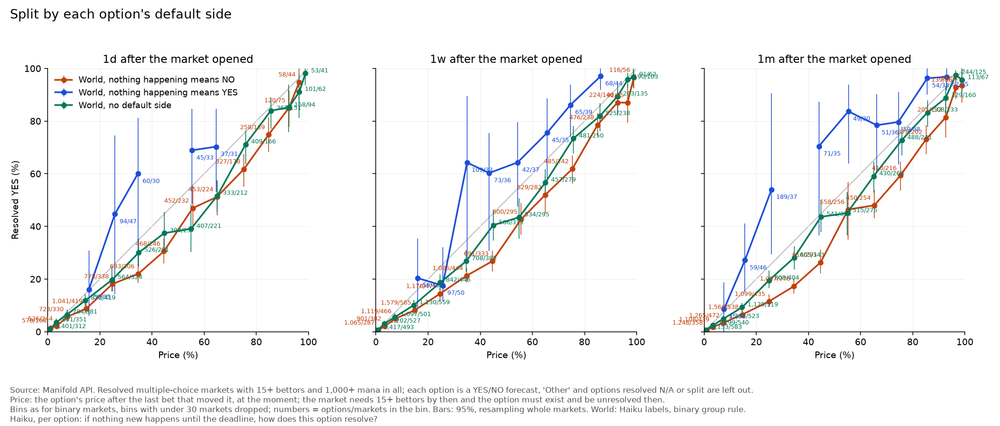

# Manifold multiple-choice options (2026-11-15)

**Multiple-choice options are calibrated just like Manifold's binary markets, bias included.** Options where "nothing happening means NO" are overpriced by about the same amount as binary markets (shift −0.63 vs −0.65). This is the first Manifold result that doesn't depend on the binary sample, so the bias isn't specific to how binary questions get written.

*We took every resolved Manifold multiple-choice market with 15+ bettors and 1,000+ mana and treated each option as its own YES/NO forecast. In one-winner markets the winning option counts as YES and every other option as NO; in the other markets each option resolves on its own. We dropped "Other", options resolved N/A, and one-winner markets resolved to a split. Price: the option's price after the last bet that moved it, 1 day / 1 week / 1 month after the market opened. The market needs 15+ bettors by then and must still be open, and the option must already exist and still be unresolved. "World" comes from Haiku labels with the same rule as for binary markets. Grey: binary world markets at the same moment with the same gate. Bins with under 30 markets are hidden; the numbers next to the dots are options/markets. Bars are 95%, resampling whole markets, because the options of one market share an outcome.*

## Nothing happening means NO

Haiku answered for each option: if nothing new happens until the deadline, how does this option resolve? World options, 1 week after the market opened:

| If nothing happens | Options / markets | Shift (95%) | Manifold binary | Polymarket |
|---|---|---|---|---|
| Resolves NO | 10,239 / 992 | −0.63 (−0.75 to −0.52) | −0.65 | −0.34 |
| No default side | 10,503 / 1,151 | −0.32 (−0.44 to −0.20) | −0.23 | −0.11 |
| Resolves YES | 731 / 356 | +0.60 (+0.08 to +1.24) | +0.52 | +0.13 |

**Same pattern as binary Manifold, in every row:** "resolves NO" is overpriced, "resolves YES" underpriced, and "no default side" sits in between. Polymarket's errors are about half the size. Counting each market once instead of each option shrinks the shifts somewhat (−0.53 / −0.19 / +0.38), but they stay clearly away from zero.

*Same data, split by Haiku's per-option answer. Each option counts 1.*

**It's a shift, not a squeeze.** Within each group, the slope of the YES rate against price in log-odds is 1.01 for both "resolves NO" and "no default side". Fitting only on options priced 20–80% gives the same shifts (−0.64, −0.32, +0.56). So the near-0% options, 19–34% of each group, don't drive the result.

## Details

- **Sample, 1 week after opening:** 38,555 options from 3,312 markets, of which 21,473 options / 1,998 markets are world questions.
- **One-winner vs independent options:** one-winner options −0.12 overall, independent options −0.52. One-winner prices sum to ~100% and exactly one option wins, so their overall shift is pushed toward 0 by construction. Their by-side split still shows the pattern (−0.24 / −0.13 / +0.43).
- **Options added after the market opened:** −0.79, vs −0.31 for options present from the start. Not dug into.
- **Labels:** Haiku 5.5 medium, one call per market, run in a cloud session; 10,352 of 10,357 markets labeled. Binary Manifold groups mostly use Jev labels instead. On the same binary markets Haiku is stricter than Jev (6.4% vs 3.0% called unsubstantive); moving the multiple-choice substantive cutoff from 20 to 5 changes the by-side shifts by at most 0.02.
- **Rerun:** `python manifold_mc/fetch.py list`, `fetch.py bets` (~3 h), `python manifold_mc/snapshots.py`, `python manifold_mc/calibration.py`. Per-group numbers: `manifold_mc/plots/metrics.csv`.
