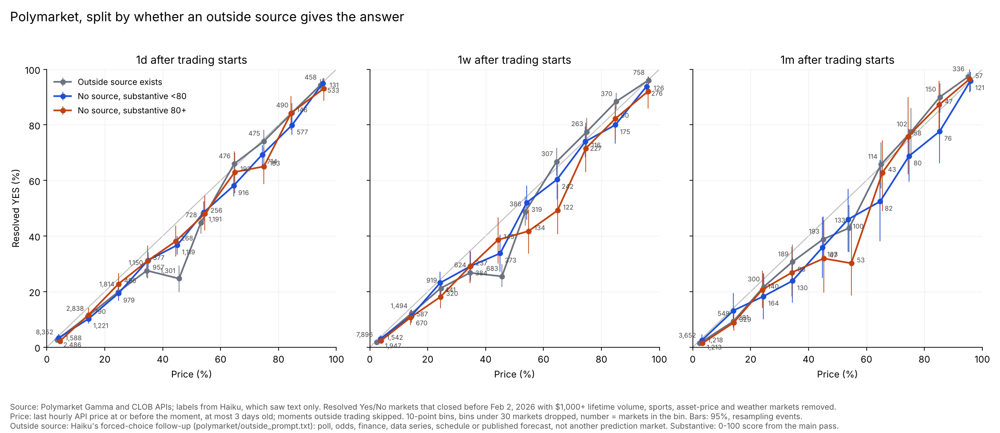

# Polymarket: first calibration with Haiku labels (2026-11-04/05)

**Polymarket overprices YES too, about half as much as Manifold, and the "no outside source" markets are no better or worse calibrated than the rest.** A week after trading starts, prices average 22.9% and markets resolve YES 20.4% of the time: a shift of −0.29 log-odds (95%: −0.34 to −0.23) on 22,228 markets in 6,801 events. Manifold's comparable number for its main "resolves NO" group was −0.65.

*We took every resolved Yes/No Polymarket market that closed before 2026-02-02 with $1,000+ lifetime volume, after removing sports, asset-price and weather markets by text rules (36,853 markets). Prices are the last hourly point of Polymarket's CLOB price history at or before each moment, at most 3 days old. Moments are 1 day, 1 week and 1 month after trading opened, and before the market closed. Moments outside trading are skipped. Each dot is a 10-point price bin with its market count. Bars are 95%, resampling events (all markets sharing an `event_title`), because brackets of one event share one outcome.*

## What the numbers say

All after trading starts, `closed_by_feb` cohort. Full table: `plots/polymarket/metrics.csv`.

| Group, 1 week after start | Markets | Shift (95%) |
|---|---|---|
| All | 22,228 | −0.29 (−0.34 to −0.23) |
| Nothing happening means NO | 8,782 | −0.33 (−0.43 to −0.23) |
| Nothing happening means YES | 296 | +0.08 (−0.35 to +0.57) |

- **Stable over horizons:** −0.31, −0.29, −0.31 at 1 day, 1 week, 1 month after start.
- **Not only the price floor.** Markets priced 5–95% have −0.27 (−0.33 to −0.21). Prices under 5% are worse (−0.66), consistent with the 0.1–1¢ floor on longshot brackets.
- **The default-side flip replicates, but weakly.** "Means YES" is positive at every horizon (+0.26, +0.08, +0.59), on only 150–440 markets. Unlike Manifold, "no default side" is overpriced as much as "means NO" (−0.26 at 1 week), so the label explains less here.
- **Close to closing it looks calibrated** (1 day before: −0.03). This moment depends on the outcome: YES "by date" markets close early. Don't read it as markets getting better.
- **Markets open on Feb 2** (separate cohort, 2,813 markets): −0.39 at 1 week after start, similar.

## Outside source: does it matter?

*Same data, 1 week after start. "Outside source" is Haiku's forced-choice answer from the follow-up below. "Substantive" is the 0–100 score from the main pass.*

At 1 week: has a source −0.29 (13,700), no source with substantive <80 −0.22 (5,054), no source with substantive 80+ −0.38 (3,419, 95%: −0.50 to −0.27). Intervals overlap. **I see no clear difference.** If anything, the "interesting" group (no source, substantive) is slightly more overpriced. Brier is higher for no-source markets (0.10–0.12 against 0.07), but that mostly reflects harder questions with prices nearer 50%, not worse calibration.

## The outside-source fix

The old `outside_reference` question gave 41% "unsure", and was inconsistent within families: Elon tweet-count brackets got half "yes", half "unsure". The new prompt (`polymarket/outside_prompt.txt`) excludes other prediction markets, forces a choice and names the kind of source. It gives family rules and about 25 examples. It runs 25 markets per call.

| Agreement with my hand labels | Old (unsure = no) | New |
|---|---|---|
| 300 random markets (tuned on) | 81% | 91% |
| 100 fresh holdout | 76% | 95% |

Labels are mine, under the new definition, made before seeing new answers. Holdout labeled after the prompt was final. The full run cost $3.16 on 39,566 markets (100 failed 3 times and are missing). Families are now consistent (all 2,162 Elon tweet markets are `data_series`). Result: 46% none, 22% data series, 12% poll, 11% odds, 5% forecast, 3% finance, 1% schedule.

**My judgment calls, which you may disagree with:** public post counters count as a source (so tweet-count brackets are "has a source"); bookmaker odds count; base rates you'd have to build yourself (word counts in past transcripts, strike frequencies) don't.

## Caveats

- The $1,000 volume gate uses lifetime volume, so it selects on later activity (flagged earlier in `findings_reference.md`).
- No bettor-count filter like Manifold's 15 bettors; the API doesn't give it historically.
- The CLOB price history is not exactly the last trade or the midpoint; see `polymarket/open_in_feb.py check`.
- Old AMM-era markets (before CLOB) have no price history and are absent.
- No Sol review of this code yet (no access from this session).

## Details

- Scripts: `polymarket/prices.py` (fetch, free), `polymarket/calibration.py` (plots and tables), `polymarket/outside.py` (follow-up labels). Plots: `plots/polymarket/`.
- Main labeling run: 39,666 of 39,666 markets, $26.48. Follow-up: $3.16 plus $0.09 testing.
- Multi-option events with exactly one YES: median price sum 1.01, mean 1.16 a week after start.
