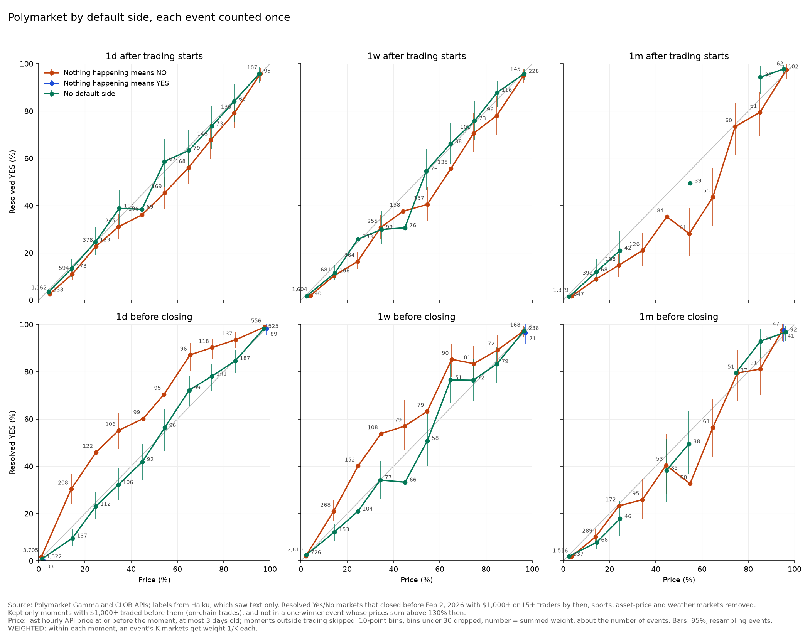

# Polymarket calibration (2026-11-08)

**Polymarket is mostly calibrated: prices are off by 2–4 points on average.** The one steady error is where nothing happening means NO: there YES is a bit overpriced after trading starts, about half as much as on Manifold. Removing junk markets doesn't change the picture.

*We took resolved Yes/No Polymarket markets that closed before 2026-02-02 with $1,000+ or 15+ traders, after text rules removed sports, asset-price and weather markets (36,853 markets). Price is the last hourly point of Polymarket's API price history at or before each moment, at most 3 days old. Moments are 1 day, 1 week and 1 month after trading opens, and before the market closes. Each dot is a 10-point price bin with its market count; bins under 30 markets are hidden. Bars are 95%, resampling events (markets of one event share an outcome).*

FILTER: a market counts at a moment only if $1,000 had traded on-chain before that moment, and not if it sits in a one-winner event whose prices then sum above 130%. Without this, empty order books show fake ~48% prices and create a dip at 40–50%. Unfiltered plots: polymarket/plots/unfiltered/.

## Nothing happening means NO

Haiku read each market's text and answered: if nothing new happens until the deadline, how does this resolve? One week after trading starts:

| If nothing happens | Markets | Price → YES rate | Shift (95%) |
|---|---|---|---|
| Resolves NO | 5,599 | 25% → 21% | −0.34 (−0.43 to −0.25) |
| No default side | 6,077 | 23% → 22% | −0.11 (−0.17 to −0.05) |
| Resolves YES | 205 | 48% → 50% | +0.13 (−0.33 to +0.57) |

Shift −0.34 means a "resolves NO" market priced at 50% comes true about 42% of the time. Manifold's same group is −0.65 (50% → 34%). The "resolves YES" group is too small to tell whether the error flips sign, as it does on Manifold.

*Same data, split by Haiku's answer. Top row: after trading starts. Bottom row: before closing.*

BEFORE CLOSING DEPENDS ON THE OUTCOME: a "by date" market closes early when YES happens, so "1 week before closing" is earlier for YES markets.

**Before closing, "resolves NO" skews upward** (+0.34 at 1 day and 1 week before closing). That's the early-closing effect above, not markets getting better. At 1 month before closing it's back to overpriced (−0.28). **"No default side" doesn't skew** (−0.11 to −0.14 at every moment), as expected, since those markets can't close early on YES.

## Counting each event once

Many markets are slices of one event: 20 tweet-count ranges, or "ceasefire by June / July / August". On the plots above each slice counts as a separate forecast. Here each event counts once: within a moment, an event's K markets get weight 1/K each. One week after trading starts:

| If nothing happens | Events | Price → YES rate | Shift (95%) |
|---|---|---|---|
| Resolves NO | 3,695 | 24% → 20% | −0.41 (−0.52 to −0.32) |
| No default side | 1,697 | 36% → 35% | −0.12 (−0.23 to −0.00) |
| Resolves YES | 119 | 59% → 63% | +0.33 (−0.15 to +0.78) |

**The picture holds and "resolves NO" gets slightly worse** (−0.34 → −0.41). "No default side" mostly loses its many cheap bracket slices, so its average price rises from 23% to 36%; its calibration barely moves. "Resolves YES" now leans the way Manifold flips, but it's still too small to tell; 1 month after start it's +0.84 (+0.02 to +1.61) on about 110 events. Before closing, the early-closing skew of "resolves NO" roughly doubles (+0.34 → +0.65 at 1 day).

*Same data and layout as the plot above, weighted. Each dot is the weighted mean price and weighted YES rate of a 10-point bin; the number is the summed weight, i.e. the number of events; bins under 30 are hidden, which hides nearly all of "resolves YES". Bars resample event titles, with weights.*

WEIGHTED: each event counts once. The unweighted version is the plot above.

**Not handled:** separate events that share one storyline ("Russia x Ukraine ceasefire before June?" and "... before July?" are two events) or repeat weekly (tweet counts, TSA). They still count fully, and the bars treat them as independent, so the bars are somewhat too narrow. Each event with its market count: `polymarket/plots/events_1w.csv`.

## Junk markets don't change it

About a third of the cleaned markets are still junk by count: "will X say Y" and post counts (26%), and rankings like Netflix charts, box office and Rotten Tomatoes (9%). One week after trading starts, all markets have a shift of −0.23; without the junk, −0.25. For "resolves NO": −0.34 with junk, −0.35 without. By dollars traded the junk is only about 8%, so it was never a big part of where the money goes.

## Details

- **Shift:** the log-odds amount added to every price so the group's mean price equals its YES rate. Zero is calibrated.
- **Filter size:** 1 week after start, 22,228 markets have a price; 11,881 pass the filter. The $1,000 rule does nearly all of it. 1,697 pre-2023 markets traded through Polymarket's old system, have no on-chain count, and drop out.
- **Still-open markets:** keeping only markets whose stated deadline passed 60+ days before Feb 2 leaves "resolves NO" at −0.34.
- **Junk kinds:** "will X say Y" is Haiku's `speech_or_posts` label (44 of 46 on 200 random markets, no false alarms). Rankings, TSA counts and AI leaderboards are text rules in `polymarket/calibration.py`, tuned on 400 hand-read markets; on 200 fresh ones they caught 24 of 25 rankings with no false alarms.
- **Dollar shares** use Polymarket's API lifetime volume, not checked for double counting.
- **Review:** Sol reviewed the filter code and found two bugs, both fixed (event price sums mixed different dates; markets open on Feb 2 skipped the event check). The kind rules weren't reviewed.
- **Rerun:** `python polymarket/prices.py volume`, then `python polymarket/calibration.py`. Per-group numbers: `polymarket/plots/metrics.csv` (`split=kind` for junk kinds), weighted in `metrics_weighted.csv`.
