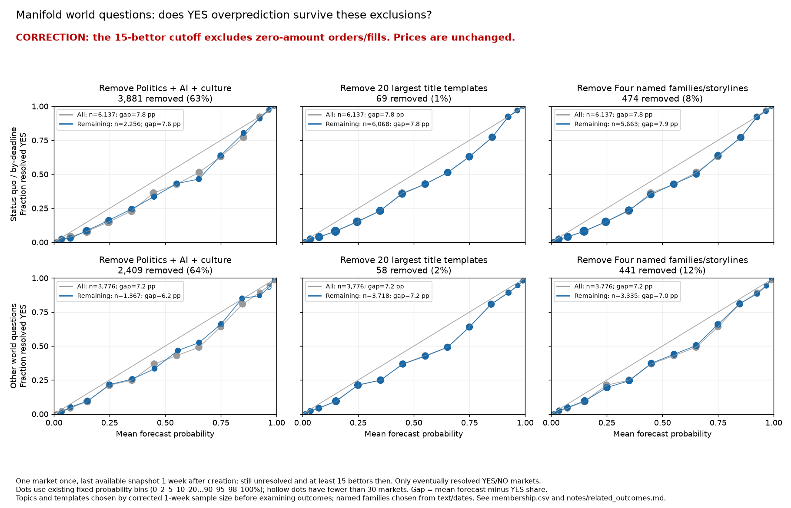
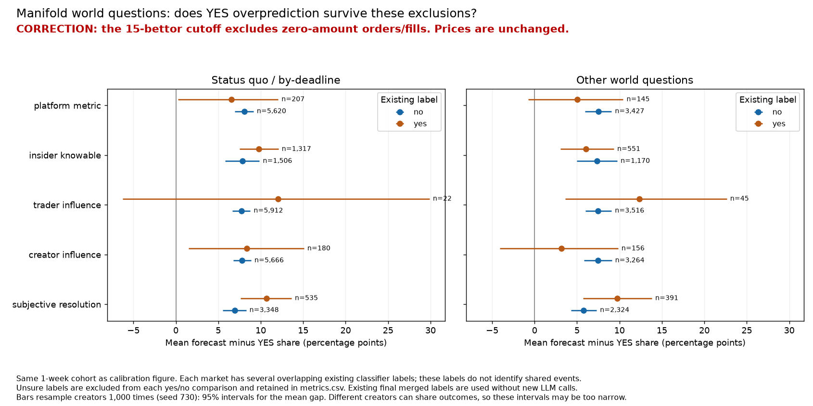

# Shared outcomes and question types: a small sensitivity check

**The downward curves survive the large groups we checked.** One week after creation, mean probability exceeds the YES frequency by **7.8 percentage points** for status-quo questions and **7.2 points** for other world questions. Removing the three largest topics, the largest repetitive templates, and four named event/storyline families together removes **64% of markets**; the gaps remain **7.5 and 6.1 points**. The remaining curves still sit below the diagonal through much of the probability range.

This weakens the explanation that these particular large groups alone produce the pattern. It does **not** establish independent observations, remove every shared event, or establish a psychological cause.

The separate question-type check also retains YES overprediction among questions labeled **not subjective**, **not creator-influenced**, and **not trader-influenced**. The subjective slices have larger point estimates, but this exploratory comparison cannot identify a cause. Some positive-label slices are small; many insider-knowable labels are unsure.

The one-day and one-month checks retain positive mean gaps after the combined exclusion. So does the stricter check using exactly the same markets at all three ages. That common sample selects markets which remain unresolved for a month and already have enough bettors after one day; it is a robustness check, not the main sample.

## Details and reproduction

Run `OPENBLAS_NUM_THREADS=1 .venv/bin/python src/related_outcomes.py` in its own tmux session, after generating `plots/activity_analysis/corrected_counts.csv`. Inputs are the existing snapshots, merged classifier results, Jev status-quo probabilities, labeling metadata, and deterministic sieve categories. No new market classification or data fetches were used.

Each resolved binary world market counts once at creation plus one week, if still unresolved and with at least 15 bettors then. The existing `plot_calibration.load()` supplies probabilities and status-quo labels: Jev probability at least 0.2 for Jev-sourced questions, otherwise the reviewer's YES label. Dots group forecasts in the existing fixed probability bins and plot mean probability against YES frequency; their size indicates market count. Hollow dots have fewer than 30 markets. These calibration curves are descriptive and have no uncertainty bars.

Groups were chosen using text, metadata, and sample size before inspecting their forecast errors:

- **Topics:** existing sieve topics, one per market; remove politics, AI, and culture separately or together. These are broad categories, not event clusters.
- **Templates:** the 20 largest creator-plus-normalized-title groups in the corrected one-week cohort; ties sorted alphabetically. Normalization replaces numbers, months, and weekdays. This can merge different dates/years, while missing paraphrases or copies by another creator. It is a repetitive-writing check, not an independence estimator.
- **Named families/storylines:** the 2024-election tag on questions created from 2023 through election day; Gaza ceasefire titles created December 2023–December 2024, excluding selected obvious unrelated phrases; first GPT-5 release/announcement titles created before 2025; OpenAI/Altman/Brockman/Sutskever titles created November 17–23, 2023. Exact deterministic rules are in the script; all primary-cohort memberships and titles are saved in `membership.csv`. The election and OpenAI groups deliberately include several outcomes, while ceasefire/release deadlines share developments without necessarily sharing identical resolutions. These four groups are examples, not an exhaustive clustering.

The top-template ranking and all group rules stay fixed for one-day and one-month checks. `metrics.csv` includes both each age's eligible cohort and a common cohort observed at all three ages. It reports retained/removed counts, mean forecast, YES frequency, their difference, and Brier score. Every deletion also has an individual row. Overlapping removals are combined by union. The five question-type labels overlap; unsure labels have separate CSV rows and are omitted from the plotted YES/NO comparisons. Their 95% intervals resample creators 1,000 times with seed 730. Creators can share outcomes, so these intervals may be too narrow.

CORRECTION: the corrected plots exclude zero-amount orders/fills from the 15-bettor eligibility count. Snapshot prices and outcomes are unchanged. Companion plots preserve the original count: [calibration](../plots/related_outcomes/calibration_original.png), [question types](../plots/related_outcomes/question_types_original.png). Full numbers for both versions are in [metrics.csv](../plots/related_outcomes/metrics.csv); plotted bins are in [bins.csv](../plots/related_outcomes/bins.csv). The original snapshot price-timestamp limitations and exclusion of markets still unresolved today remain.

The end-to-end script completed and the corrected plots were visually inspected. Required Opus-high `/simplify` review could not complete: automatic approval review rejected sending project instructions/source through the external Claude CLI. No alternate external review was substituted.
