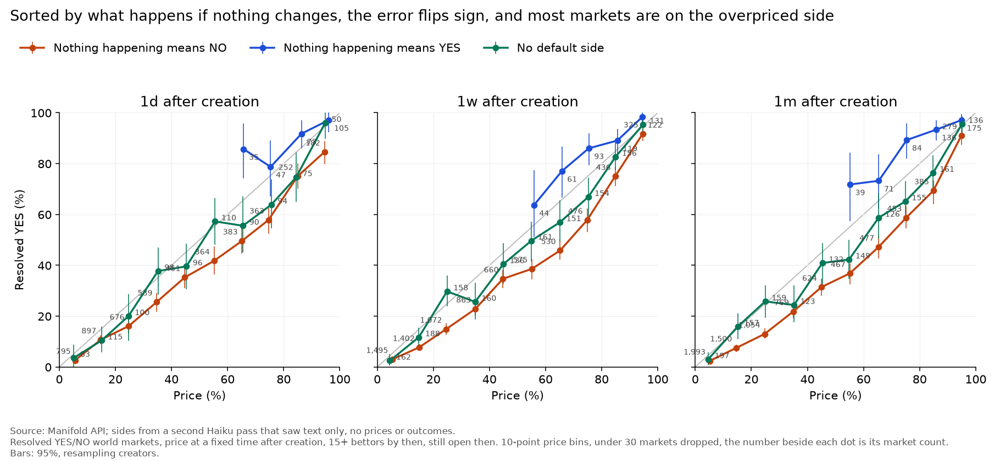
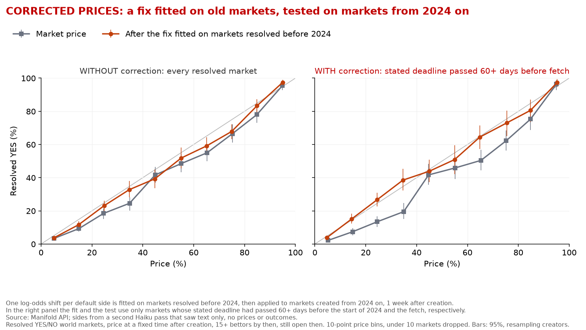
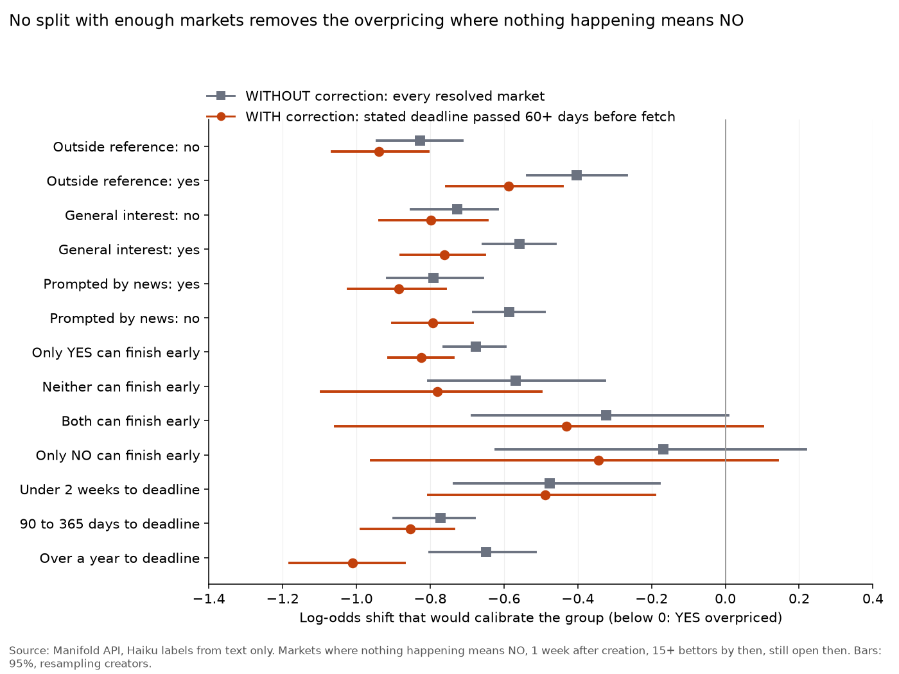

# Manifold calibration, re-sorted with the second Haiku labels

**Update, 2026-11-04: numbers here use the old bettor counts, off by at most about 0.2 points. [findings_reference.md](findings_reference.md) has current numbers and everything else.**

**The downward lean is almost entirely one kind of question, and a simple fix learned from old markets removes it on later ones, but I still can't say why it exists.** Haiku labeled nearly every Manifold market from its text alone. Where nothing happening means NO, markets are priced at 36% and resolve YES 27% of the time, 97% of the world gap. Where nothing happening means YES, the error flips: 70% against 77%.

This replaces regexes and hand labels with one label on every market, and the main finding from [yes_bias_debug.md](yes_bias_debug.md) holds. The new labels also rule out one lead from that report and reopen one explanation it rejected.

*We took resolved YES/NO Manifold world markets and priced each at a fixed time after creation, requiring 15+ bettors by then and the market still open. Haiku saw only the text and answered: if nothing new happens until the deadline, how does this resolve? Each dot is a 10-point price bin; bins under 10 markets are dropped. Bars are 95%, resampling creators.*

## What the split shows

All numbers are 1 week after creation. "Shift" is the log-odds you'd add to every price to make the group's mean price equal its YES rate; zero is calibrated.

| If nothing happens | Markets | Shift |
|---|---|---|
| Resolves NO | 7,834 | −0.65 (−0.72 to −0.57) |
| Resolves YES | 543 | +0.53 (+0.32 to +0.75) |
| No default side | 1,557 | −0.23 (−0.35 to −0.11) |

- **The flip replicates on new markets.** On 260 "resolves YES" markets I had not hand-labeled as such, the shift is +0.43 (+0.11 to +0.77).
- **It really is a shift.** The slope of YES rate against price in log-odds is 1.00 (0.95 to 1.05) for the "resolves NO" side, so the error has about the same log-odds size at every price.
- **"No default side" is not clean.** With no stated deadline it's close (802 markets, 1.7 points, −0.10, −0.24 to +0.03). With a stated deadline it's still overpriced. So the sort concentrates the error but doesn't explain all of it.

## The gap with still-open markets removed

CORRECTION: every "corrected" number here keeps only markets whose stated deadline passed at least 60 days before the data was fetched.

This filter removes the skew from markets still open, whose resolved part leans YES. It also removes every market with no stated deadline, so the mix changes.

The "resolves NO" side goes from 36.3% against 26.9% to 35.6% against 23.9%, a shift of −0.81. By creation year, 2022 to 2026, the corrected shift is −0.96, −0.87, −0.69, −0.72, −0.78. Uncorrected, 2026 looks nearly fixed at −0.21. That's mostly still-open markets, and there has been no clear improvement since 2024.

## A fix learned from old markets works on later ones

*We fit one log-odds shift per default side using only markets resolved before 2024, then applied it to markets created from 2024 on, 1 week after creation. Right panel: the fit uses deadlines passed 60+ days before 2024, the test uses deadlines passed 60+ days before the fetch. Left panel: no such filter, so the fit sees early YES resolutions but not markets still open, and it under-corrects. Orange prices are changed by the fix; gray are raw.*

- **Corrected:** the gap falls from 8.4 points to 0.2, and Brier from 0.140 to 0.131 (change −0.010, −0.014 to −0.006) on 3,293 markets.
- **Uncorrected:** the gap falls from 5.6 to 2.7 points, Brier from 0.147 to 0.143.
- **The label adds little to the fix.** A single shift for all markets gets most of the gain (corrected Brier change −0.008). Most markets are on the "resolves NO" side.

This shows the error is stable, not that it can be profitably traded. Fees, spread and locked-up mana aren't counted.

## Your early-finish question

**Early finish doesn't look like the driver, though the data can only partly separate them.** The two labels mostly coincide: 89% of "resolves NO" markets are ones where only YES can finish early.

Within "resolves NO", markets where neither side can finish early are as overpriced as those where only YES can: corrected −0.82 (262 markets) against −0.83 (5,530). Where both or only NO can finish early the overpricing looks smaller, but on about 100 markets each, and the intervals include zero.

Among markets with no default side, the direction is opposite to what the idea predicts: +0.06 when YES can finish early, −0.51 when NO can, both with wide intervals.

## What else moved within "resolves NO"

*Same data, 1 week after creation. Gray: every resolved market. Orange: stated deadline passed. Splits use Haiku's text-only answers, and days to the deadline are counted from the snapshot.*

- **The niche-question lead is gone.** The earlier report's one remaining lead was thin attention. Corrected, questions of no general interest have a shift of −0.80, those of general interest −0.76. The uncorrected difference was mostly still-open markets.
- **An outside reference may help, but doesn't fix it.** Corrected: −0.94 with no outside forecast or number, −0.60 with one. This label is the least stable, changing on 29 of 100 reruns, so I treat it as a lead only.
- **News-prompted questions:** −0.89 against −0.80, with overlapping intervals. Not established.
- **More time left goes with more overpricing, which corrects my earlier report.** Corrected, the shift runs from −0.49 under 2 weeks to −1.00 over a year, and it also rises within 2023 and 2024 markets. Betting NO returned 10% under 2 weeks and 22% over a year. The earlier report said returns were flat and rejected lock-up. Lock-up may now explain part of the long-dated excess. It can't explain a 10% return in under two weeks.

## What I trust and what I don't

**I trust:** the error sits on the side where YES needs something to happen, it flips on the other side, and it's stable enough that a fix learned before 2024 works afterward.

**I don't know why it exists.** Early finish, niche questions and news prompts don't account for it. Time left and outside references are partial leads, and neither removes it. So "explain why" is still not met. "Find what it belongs to" is.

**Labels could know the future.** Haiku saw no prices or outcomes, but it may remember how old events ended. The earlier text rule found the same flip with no model, which argues against this being the cause, but I didn't test the new labels on events after Haiku's knowledge cutoff.

## Details

- **Run:** `python manifold/second_pass_analysis.py`, then `python manifold/second_pass_plots.py`. Numbers are in `manifold/plots/second_pass/metrics.csv`, `bins.csv`, `before_deadline.csv`.
- **Labeling:** 37,672 of 37,680 markets, $19.19 at list price, in a cloud session using `claude -p`. Of the 8 missing, 4 are rot13 titles whose calls failed and 4 returned an invalid `early_side`. 3 of the 8 are in the 1-week sample of about 12,240 markets.
- **Deadlines:** 31 stated deadlines were impossible or before creation, and are treated as missing. On titles with an unambiguous date, the stated deadline is within a day in 97% of 4,228 markets.
- **Label against hand labels:** of 302 hand-labeled YES-default markets, Haiku said YES on 284.
- **Review:** Sol reviewed the code and found five issues. Fixed: the fit used outcomes known only after 2023, 149 snapshots came after the market's close, and bins with one outcome showed zero-width intervals. Still true: 453 markets past their title date are unresolved and missing, about 2%. `before_deadline.csv` compares a different set of markets at each point, so I don't headline it. The fixes themselves were not re-reviewed.
- **Sample:** adding the still-open check drops 149 markets at 1 week, so this report's world gap is 7.7 points rather than 7.6.
- **Not done:** Polymarket has no new labels, so none of this is tested there. Intervals resample creators, which ignores markets sharing one event; resampling deadline months gave a similar range in the earlier analysis.
