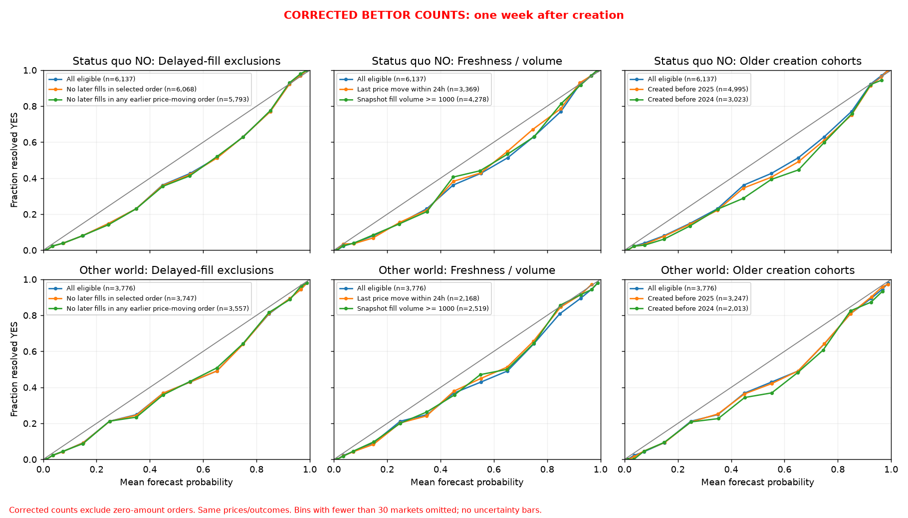

# Delayed fills, stale prices, and older questions

**These checks do not explain the downward calibration curves.** Excluding orders with later fills barely changes the result. Keeping only prices updated within a day leaves roughly **7 percentage points** of YES overprediction. Older creation cohorts have a larger gap, not a smaller one. This is descriptive evidence; we have not estimated whether small differences between these overlapping samples exceed sampling noise.

**The suspected delayed-fill price leak is not supported by the source paths checked.** Manifold's [current maker-update code](https://github.com/manifoldmarkets/manifold/blob/fd9cd4e26000b8a3a17306ce53e8d752f84c7765/backend/api/src/helpers/bets.ts) and [late-2023 implementation](https://github.com/manifoldmarkets/manifold/blob/7c518f42f5577689cf5df058e4f9b023f3081e08/backend/api/src/place-bet.ts#L443) append fills and update amounts, shares, and completion status; they do not replace the resting order's `probAfter`. An order having a fill after the snapshot therefore does not establish that its stored price contains future information. This checks two source versions and their normal maker-update paths, not every historical deployment or possible write path.

CORRECTION: bettor eligibility excludes zero-amount orders. Prices and outcomes are unchanged. The companion plot uses the original counts.

The [original-count companion](../plots/selection_audit/calibration_original.png) preserves the uncorrected analysis. Existing headline plots and snapshot parquet were not overwritten.

**Selection is still unresolved.** Histories were fetched only for eventually resolved binary YES/NO markets meeting lifetime activity thresholds. Older questions can still be unresolved, so the older-cohort check does not remove that selection. The snapshot fill-volume filter also does not establish that the lifetime platform-volume gate is harmless: our sum of absolute fills has not been reconciled to the platform's volume definition. The delayed-fill exclusions themselves use future information and are diagnostic stress tests, not a recommended sampling rule.

## Details and reproduction

Run `OPENBLAS_NUM_THREADS=1 .venv/bin/python src/selection_audit.py` from the project root in a separate tmux session. It reads the existing snapshots, classifier groups, corrected counts, market metadata, and local raw orders. No new market labels or data downloads are required. The run completed with assertions checking ordering and agreement between reconstructed selected prices and stored snapshots.

Each market contributes once, one week after creation, if still unresolved then and with at least 15 bettors by that time. Separate rows show status-quo-NO and other world questions under the existing classifier rule. Each comparison starts from its row's eligible sample and applies one additional restriction. The delayed-fill checks exclude either the selected price-moving order having a later nonzero fill, or any earlier price-moving order having one. Other checks require a price move within 24 hours, at least 1,000 cumulative absolute fill amount by the snapshot, creation before 2025, or creation before 2024. These are different market samples, not causal estimates.

Points use the existing fixed probability bins and show mean forecast against realized YES frequency. Bins with fewer than 30 markets are omitted from figures but retained in the CSV. There are no uncertainty bars; related outcomes remain dependent. [metrics.csv](../plots/selection_audit/metrics.csv) contains full sample sizes and mean gaps; [bins.csv](../plots/selection_audit/bins.csv) contains plotted values; [membership.csv](../plots/selection_audit/membership.csv) records per-market flags. Full-sample summary gaps include every eligible market, including small bins omitted from the plot.

No Claude review or simplification was run for this continuation, as requested. The earlier interrupted review left no recoverable findings or source edits.
