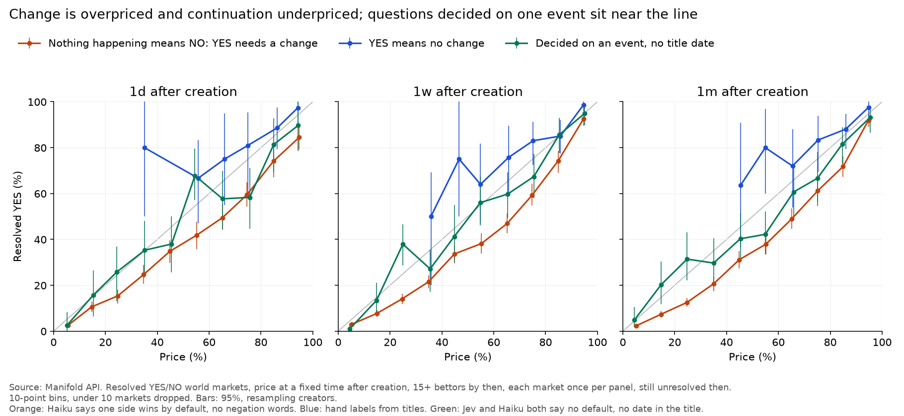
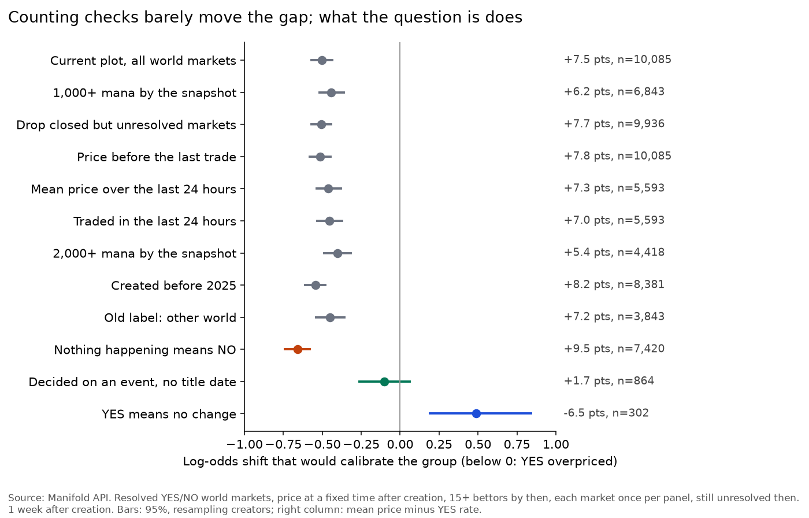
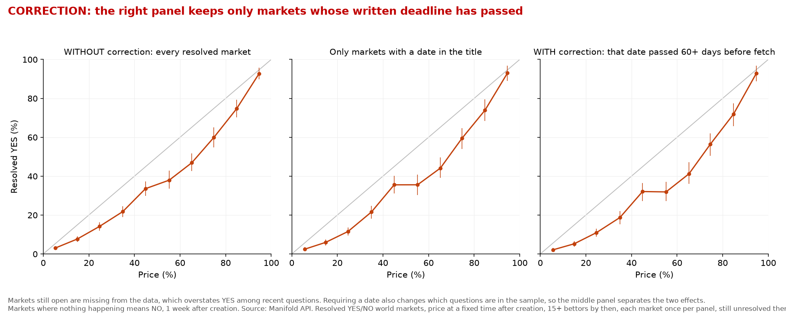
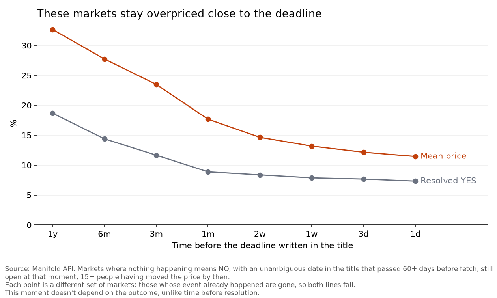
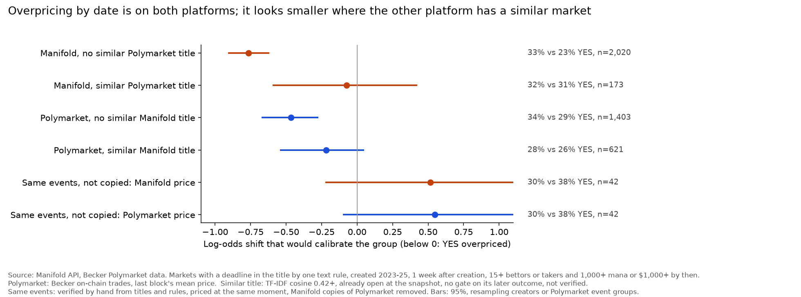

# Why Manifold world markets sit below the diagonal

**Update, 2026-11-03: [second_pass_results.md](second_pass_results.md) confirms the main finding with labels on every market, and corrects three things here.** The thin-attention lead fails once still-open markets are removed. Returns to betting NO aren't flat with time left, so lock-up isn't fully rejected. The "fit on 2023 and earlier" test below uses outcomes known only later. Numbers below are unchanged.

**This is not a counting bug. Questions where nothing happening means NO are overpriced, and they cause 93% of the gap.** One week after creation, they are priced at 36% and resolve YES 26% of the time. The bias isn't toward YES: when YES means nothing changes, the market is underpriced, 73% against 80%. Questions decided on one scheduled event, with no date in the title, are close to calibrated: 50% against 49%.

Polymarket shows the same overpricing with real money, at about half the size. **Why these questions are overpriced is still not explained.** I tested many explanations and most fail. The one lead left, that this is a problem of thinly watched questions, is suggestive and not established.

*We took resolved YES/NO Manifold world markets, priced each at a fixed time after creation (last price-moving bet), and required 15+ bettors by then and the market still open. Each market counts once per panel. Each dot is a 10-point price bin, showing mean price against YES rate; bins under 10 markets are dropped. Bars are 95%, resampling creators. Orange: Haiku says one side wins by default, and the title has no negation words. Blue: my hand labels, from titles only. Green: Jev and Haiku both say no default, and the title has no date.*

## What moves the gap

"Shift" below is the log-odds you'd add to every price to make the group's mean price equal its YES rate. Zero is calibrated; −0.66 means YES odds are overstated about 1.9 times. All numbers are at 1 week unless stated.

- **The split into "status quo" and "other world" was wrong.** Other world has a 7.2-point gap, but most of it comes from markets the old label missed. Where both labelers agree there's no default and the title has no date, the gap is 1.7 points (shift −0.10, interval −0.26 to +0.06). At 1 month it's 2.9 points, so "close" isn't "zero".
- **The sign flips with the meaning of YES.** Shift is −0.66 when nothing happening means NO, and +0.49 (+0.19 to +0.84) when YES means no change, on 302 hand-labeled markets. Two random halves of creators give +0.48 and +0.50. A text rule with no model finds the same flip (−0.74 and +0.43), so LLM labels leaking outcomes can't be the cause.
- **It isn't specific to world markets.** Sport, prices and similar markets look fine only because most of them have no default side. Their "nothing means NO" subset has a shift of −0.58, the rest +0.16.
- **Polymarket has it too.** Using one text rule for by-date questions on both platforms, created 2023–2025, with $1,000 or 1,000 mana by the snapshot: −0.39 (−0.56 to −0.24) on Polymarket, −0.71 (−0.84 to −0.59) on Manifold. Polymarket has no default starting price. The flip can't be tested there: only 36 such markets (−0.36, interval −1.25 to +0.81).

## Explanations that fail, with sizes

*Same data, 1 week after creation. Gray rows change the measurement or drop a suspect group; colored rows split by question type. Right column is mean price minus YES rate.*

- **Pipeline bugs:** 486 coin-flip markets at 1 day are priced at 49.9% and resolve YES 50.0%. Only 0.4% of markets have a price jump over 2 points between consecutive moves, and the last price matches the stored price within 1 point in 99.9%.
- **Frozen, stale or impact-inflated prices:** dropping closed markets, using the price before the last trade or using a 24-hour mean moves the shift by at most 0.05 (from −0.50).
- **The 1,000-mana fetch gate:** I expected this to fake the flip, because early-resolved markets have less time to reach it. It doesn't: excluded markets resolve YES 39.2%, included ones 38.6%. Requiring 1,000 mana by the snapshot, which needs no future, still gives −0.44.
- **Dropped N/A and percent resolutions:** these are 1.9% of by-date markets. Even if every one should have been YES, that adds about 2 of the 9.5 points.
- **Wrong resolutions:** erasing the 55–85% gap needs 34% of NOs to be wrong. I read 60 and found 6 disputed, 11 counting subjective or inactive-creator calls. Low-priced YES markets are disputed too (7 of 30), so errors run both ways. This is my reading of titles and comments, not an outside check.
- **Lock-up of mana:** betting NO earned 17–27% whether 14 days or 2 years remained. Lock-up predicts returns growing with time. Markets with over 2 years left earned 2%, but most of those are still open and missing. The overpricing is also already there 12 hours in.
- **The 50% start:** markets started below 40% have the same shift (−0.65), but only 93 markets (−1.43 to −0.10), and creators choose those starts. So this argues against it weakly.
- **New traders alone:** they push prices toward YES (+0.20 log-odds on average) while experienced traders push down. But moves by every kind of trader carry about the right information (coefficients 0.91 to 1.04), with a constant −0.64 left over. Where experienced traders make most of the moves, the shift is −0.43; where they make least, −0.86. That's a difference between sets of markets, not proof they'd fix it.

## The gap is bigger than the plot shows

CORRECTION: this section's "with correction" numbers keep only markets whose deadline in the title passed at least 60 days before the data was fetched. Both versions are shown.

*Markets where nothing happening means NO, 1 week after creation, same method as the first plot. Left: every resolved market. Middle: only those with a date in the title (regex). Right: only those whose date passed at least 60 days before fetch.*

7,708 active markets are still unresolved, 13–32% of each creation year. Among markets with a title date still ahead, 3,756 are unresolved and only 827 have resolved, at a mean final price of 63%, so that part of the data is skewed toward YES. Once the date has passed, the data is nearly complete: 453 unresolved against 19,136 resolved.

- **Shift:** −0.66 for all, −0.74 with a title date, −0.87 with that date passed. So roughly the first step is a different mix of questions and the second is the correction. The gap goes from 9.5 to 10.8 to 12.4 points.
- **Change over time:** uncorrected, the shift goes from −0.90 in 2022 to −0.20 in 2026. With the correction it goes −1.07, −0.94, −0.75, −0.66, −0.72. So most of the apparent recent improvement disappears, and a smaller one remains: about 0.3 since 2022, and also about 0.2 among markets with no date.

The overpricing also survives close to the deadline: one day before it, markets still open are priced at 11.4% and resolve YES 7.3% (shift −1.08, −1.21 to −0.97). This uses only unambiguous dates and requires 15 people to have moved the price by that moment.

*Markets where nothing happening means NO, with an unambiguous date in the title that passed at least 60 days before fetch, still open at each moment. Each point is a different set of markets. Unlike time before resolution, this moment doesn't depend on the outcome.*

## Comparing the two platforms directly

*Markets with a deadline in the title by one text rule, created 2023–2025, 1 week after creation. Polymarket prices are the mean of the last block's on-chain trades, from the Becker dataset, outside sport and crypto. "Similar title" means TF-IDF cosine of at least 0.42 with a market already open at the snapshot, with no filter on how it later ended; not verified. "Same events" are pairs I verified from titles and rules without seeing prices or outcomes, priced at the same moment.*

- **Same event, same moment: no clear average difference, but Manifold is less accurate.** Over 81 by-date pairs, Manifold minus Polymarket is −0.09 in log-odds (−0.27 to +0.08). I fixed a margin of ±0.25 before looking, and this slightly exceeds it, so I can't call them equal. Individual prices differ by 8.7 points on average, and 26% differ by 10 or more. Manifold's Brier is worse: 0.154 against 0.130 (difference +0.024, −0.016 to +0.062). On 40 fixed-date pairs it's clearly worse: 0.170 against 0.126 (+0.043, +0.014 to +0.068), though these are mostly elections.
- **About half of those by-date pairs are copies.** 43 of 91 Manifold markets copy Polymarket's rules or say they resolve the same way, so they aren't independent. Without them the difference is −0.05 (−0.27 to +0.18, 42 pairs).
- **These pairs aren't overpriced on either platform:** 25% against 33% YES, shift +0.58 (+0.03 to +1.10). They are high-profile events that I selected for being on both platforms, so this says little about typical markets.
- **A similar market elsewhere may go with less overpricing, but this is only a lead.** Manifold: −0.07 (−0.61 to +0.41, n=173) with, −0.76 without. Polymarket: −0.22 (−0.54 to +0.05, n=621) with, −0.47 without. It isn't stable: on Manifold markets from 2025 it reverses (−0.78 against −0.50, 54 markets with a match). An earlier version of this check, with weaker rules, looked much stronger.

## What I trust and what I don't

**I trust:** no counting artifact I could find produces this, and the effect belongs to "something must happen", not to YES on Manifold. It's stable enough to use: a shift fitted on markets from 2023 or earlier improves Brier from 0.140 to 0.137 and log loss from 0.433 to 0.424 on 3,598 markets from 2024 onward. That doesn't show it's profitable after trading costs.

**I partly trust:** more trading helps but doesn't finish the job. The shift is −0.74 under 2,000 mana and −0.35 above 20,000. These are different markets, so this isn't causal.

**I don't know why these markets get overpriced.** The natural story is that few people bother to bet NO on a niche question that pays nothing until the deadline, while the question exists because someone found the event plausible. Nothing here proves it. Traders do know the pattern: one audited comment says "things generally don't happen".

**Where your prior holds and where it doesn't.** You're right that Manifold users don't simply favor YES. But the overpricing is real rather than a recount artifact, and on the same events Manifold's average price matches Polymarket's while its accuracy is lower. "Manifold users aren't biased" doesn't survive this.

## What this changes

- **Stop plotting "status quo vs other" from the old label.** Split by what YES means and by whether a market has a deadline.
- **Measure "before resolution" from the deadline in the question.** That removes the outcome-dependent moment. It needs a proper deadline label.
- **Don't filter on Manifold's tags.** `new-years-resolutions-2024` looked like a huge fix: removing it takes the gap from 7.5 to 5.7 points. But it depends on the outcome: tagged markets that resolved around that New Year went YES 13% of the time, untagged ones 44%. Removing it would be p-hacking, so I didn't.

The questions to add for the next Haiku run are in [second_pass_questions.md](second_pass_questions.md).

## Details

- **Run:** `python manifold/yes_bias.py unresolved`, `moves`, `polymarket`, `analyze`, then `python manifold/yes_bias_plots.py`. Full numbers are in `manifold/plots/yes_bias/metrics.csv`, `bins.csv`, `before_deadline.csv`, `pairs.csv`.
- **Labels I made by hand:** `manifold/other/labeling_review/yes_bias/`. Polarity and pairs were labeled without prices or outcomes, though I remember how some famous events ended. The resolution audit necessarily saw outcomes.
- **Labels:** Haiku catches 104 of 106 status-quo markets Opus found in the reviewed world markets, Jev at 0.2 finds 86; these reviewed markets are not a random sample. The orange group is not the same as "has a date": 2,580 of its 7,420 markets have no date in the title (shift −0.50).
- **Not independent:** intervals resample creators, which ignores markets sharing one event. Resampling deadline months instead gives −0.83 to −0.52 for the −0.66 shift. The "no date" group is dominated by elections, so its interval is probably too narrow.
- **Not tested:** markets Manifold deleted or hid. Polymarket uses last-block trades, not midpoints, and its data ends in February 2026. 8 of the 142 hand pairs were dropped because their rules differ; two by-date pairs with different outcomes are kept.
- **Review:** Sol found six bugs and Astra four over-strong claims in an earlier version; all are fixed or tested above. Fixes changed the deadline parser, the before-deadline check, the Polymarket volume gate and last-trade rule, and the similar-title pool. The result weakened the similar-title claim and reversed "Manifold isn't worse". **Sol's second review of those fixes did not run because of a usage limit.** I read the changed code myself and fixed two more parser bugs, so the final code has had no outside review.
- **Earlier notes this corrects:** `manifold/other/plots/activity_analysis/README.md` and `notes/other/selection_audit.md` treat the downward lean as unexplained and read older cohorts' larger gap at face value; much of that difference is the missing open markets.
