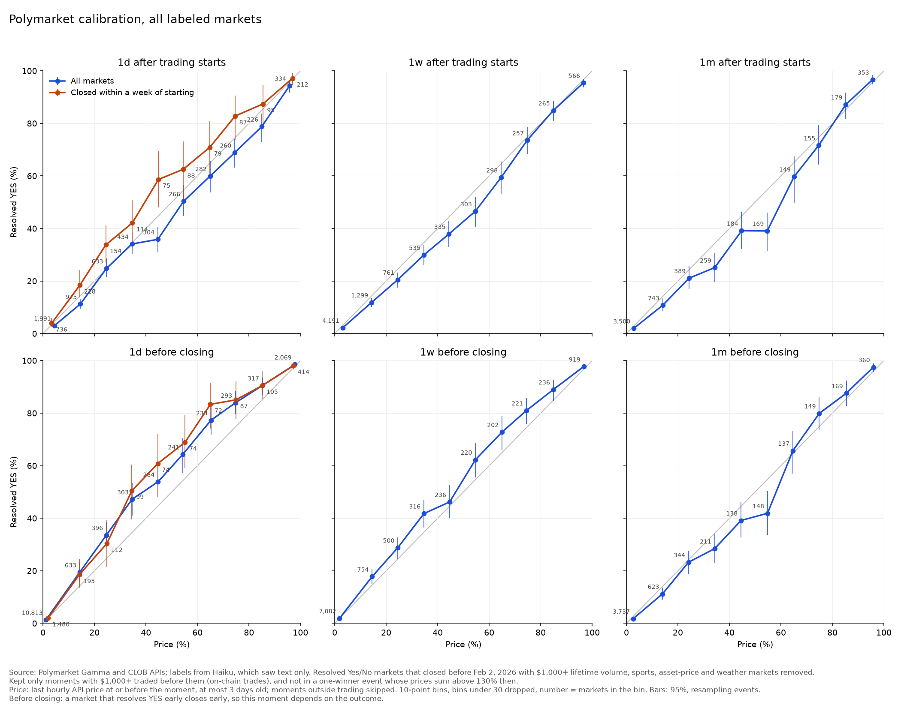
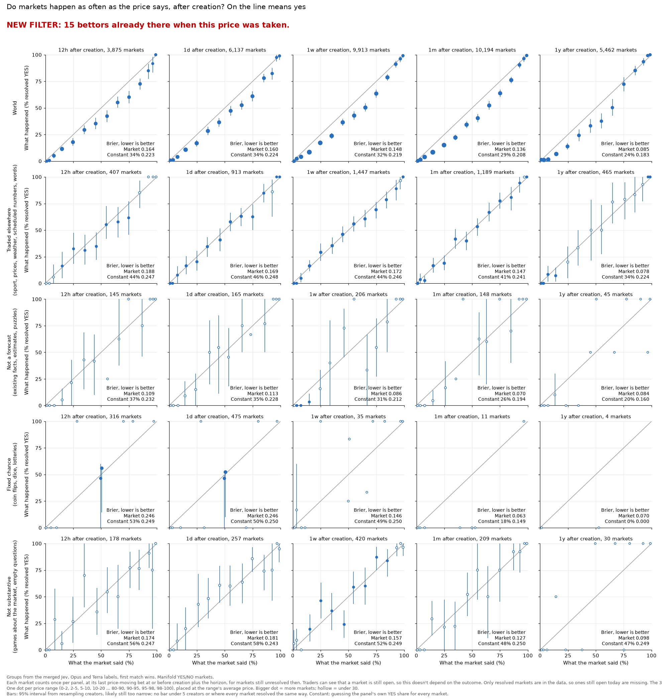
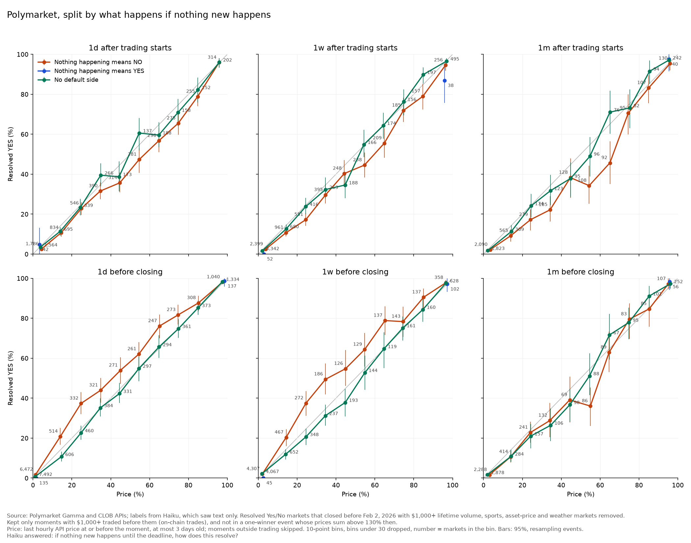
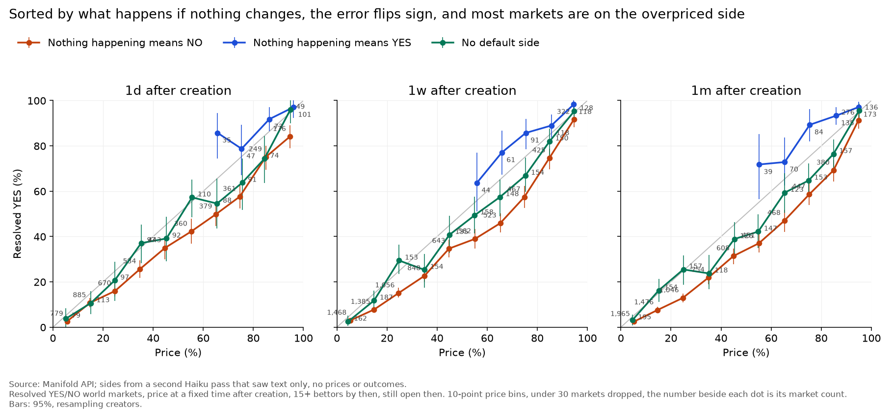
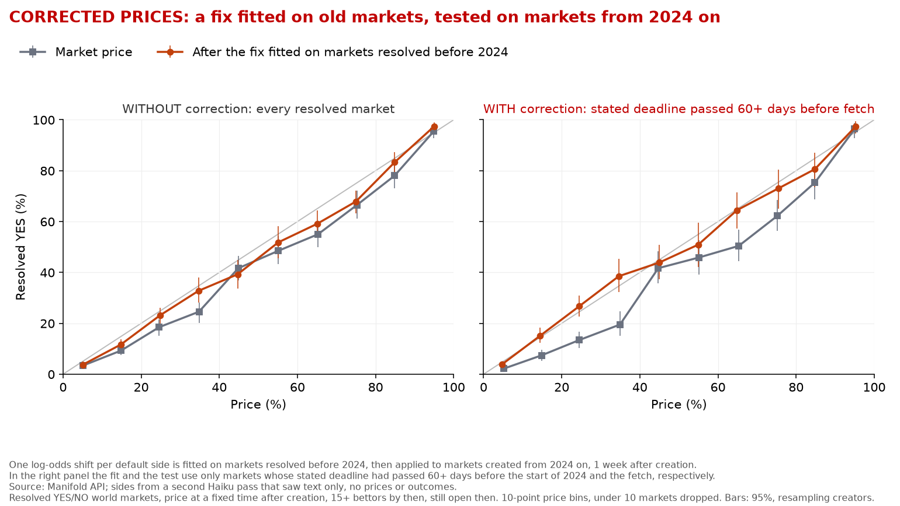
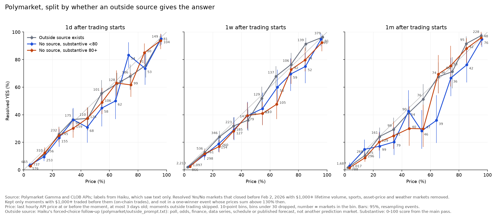
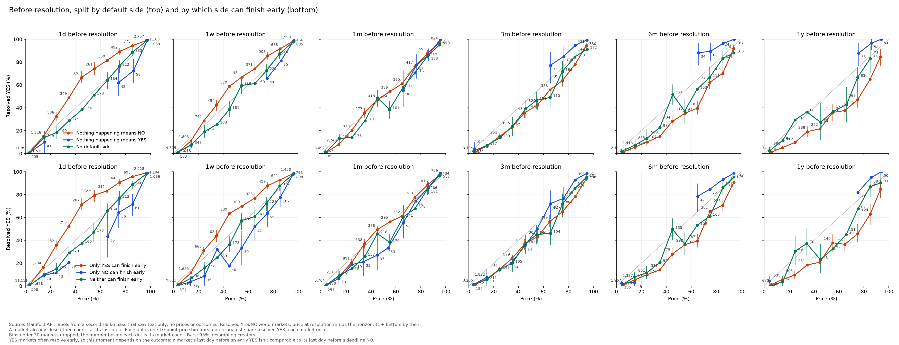

# Are Polymarket and Manifold calibrated on questions that matter?

## Short answer

We checked whether prices on Polymarket and Manifold match how often things actually happen. We used resolved yes/no questions about the world, after removing sports, asset prices, weather, coin flips and other mass-produced, self-referential etc. markets.

**Both platforms are reasonably calibrated, with one predictable bias that is about twice as large on Manifold.**

- **Polymarket**, 1 week after trading opens (11,881 markets that closed before 2026-02-02 and had $1,000 traded by then): mean price 24.4%, resolved YES 22.4%. Brier score 0.087, against 0.174 for always guessing the base rate.
- **Manifold**, 1 week after creation (9,762 markets with 15+ bettors by then, fetched 2026-10-30): mean price 40.0%, resolved YES 32.3%. Brier 0.148, against 0.219.
- **The bias:** when "nothing happens" means NO ("Will X happen by June?"), YES is overpriced. On Polymarket a market priced at 50% comes true about 42% of the time; on Manifold about 34%. On Manifold the bias flips sign when "nothing happens" means YES. Polymarket has too few such markets to tell.
- **The bias is stable over time.** A correction fitted on Manifold markets resolved before 2024 removes the gap on markets created from 2024 on (8.3 points → 0.1).
- **Markets with an outside reference are better calibrated.** We wanted to know whether markets look calibrated only because bookmakers, polls and schedules do the work for them. Partly yes. On Polymarket, markets with an outside reference such as a poll, odds or a schedule are close to calibrated (shift −0.13). Substantive questions without one are more overpriced (−0.40), though still only off by about 4 points on average.
- **"N days before resolution" flatters the markets.** The outcome decides when a question resolves, so it also decides which price gets measured. Measured that way, the bias mostly disappears close to resolution. We therefore headline prices at fixed times after a market opens.

## Why redo this

Two large 2026 studies already say prediction markets are well calibrated: Dickerson et al. in PNAS (about 1M records from Kalshi, Manifold, Polymarket and Metaculus) and Reichenbach & Walther on SSRN (779,344 Polymarket markets). We had two concerns.

**First: what the sample is made of.** Most of R&W's markets are crypto (302,890) and sports (369,950), and PNAS's pooled result mostly describes Kalshi. Those markets have an outside source of truth -- a market can look calibrated there just by copying it. A much more interesting question is the following: on questions where no easy outside answer exists, do the prices still mean what they say? 

**Second: two method problems.**

- **Picking the winner.** For multiple-choice questions on Manifold and Metaculus, the open-source tool the PNAS authors used to collect their data (Themis) keeps only the option that won and records it as YES. That keeps "priced 30%, happened" and drops every "priced 30%, didn't happen", moving the hit rate up.
- **Measuring at a time chosen by the outcome.** Both papers place their measurement times in a way which picks different moments for YES and NO markets (section 6). Our main numbers use fixed times after a market opens, which don't depend on the outcome.

## What we measure

**A forecast** is a market's price at a fixed moment: 1 day, 1 week or 1 month after trading opens (Polymarket) or after creation (Manifold). Each market counts once per moment. A market's forec is included in our analysis only if it was still open and already active at that moment, and additionally:

- **Polymarket:** $1,000 traded before the moment. We also drop many-options-one-winner events whose prices sum above 130% at that moment, because untraded markets show up as 50%. The price is the last hourly point of Polymarket's API price history, at most 3 days old.
- **Manifold:** Only a 2-option market to avoid multiple-progressively added options. 15 distinct bettors by the moment. The price is the probability shown after the last trade.

**Calibration** is shown as plots: markets grouped into 10-point price bins, mean price against the share that resolved YES. Bins with under 30 markets are hidden.

**The shift** is the amount added to every price's log-odds that makes the group's mean price equal its YES rate.

**Error bars** are 95% bootstrap intervals. On Polymarket we resample platform-labelled events, which are markets sharing an outcome. On Manifold we resample creators. NEED REDO CIS THIS IS STUPID
CAN ADD MULTIPLE OPTION MARKETS NO PROBLEMO ACTUALLY

**Data.** Polymarket: resolved yes/no markets that closed before 2026-02-02 with $1,000+ volume or 15+ traders, after text rules removed sports, asset prices and weather (36,853 markets). Manifold: resolved yes/no markets with 15+ bettors and 1,000+ mana volume over their lifetime (37,680), of which 27,752 are about the world. The rest are sports, prices and weather (7,782), coin flips (571), games about the market itself, and similar.

## 1. Overall: reasonably calibrated

*Polymarket. Resolved yes/no markets as described above. Price 1 day, 1 week and 1 month after trading opens, and before close. A market counts at a moment only if $1,000 had traded on-chain before it. Dots are 10-point bins with market counts; bars resample events.*

FILTERED: only markets with $1,000 traded before the moment. Unfiltered plots: polymarket/plots/unfiltered/.

*Manifold, by market group. Price at fixed times after creation, markets with 15+ bettors by then and still open. Bars resample creators.*

| 1 week after opening | Markets | Mean price → YES |
|---|---|---|
| Polymarket | 11,881 | 24.4% → 22.4% |
| Manifold, world | 9,762 | 40.0% → 32.3% |

**Polymarket is off by about 2 points on average** at 1 day, 1 week and 1 month (shift −0.21 to −0.29). **Manifold world markets are off by about 8 points** (shift −0.51).

**Both carry a lot of information.** Brier at 1 week is 0.087 on Polymarket and 0.148 on Manifold, against 0.174 and 0.219 for always guessing the base rate. A market that is perfectly calibrated but useless, like a constant 50% on a coin flip, would score no better than the base rate.

**On Manifold, sports and prices are better calibrated than world questions.** At 1 week the gap is +0.8 points on sports, prices and weather (1,447 markets), against +7.7 on world questions. Coin-flip markets come out exact: priced 49.9%, resolved 49.9% (475 markets).

## 2. The bias: "something happens" is overpriced

We asked Haiku one question about each market's text, without prices or outcomes: *if nothing new happens until the deadline, how does this resolve?* "Will X launch by June?" resolves NO. "Will X still be CEO at year end?" resolves YES. "Will X win the election?" has no default side.

*Polymarket, same data as section 1, split by Haiku's answer. Top row: after trading opens. Bottom row: before close (see section 6).*

*Manifold world markets, same data as section 1, split by the same Haiku question. Bins under 10 markets dropped. Bars resample creators.*

**Shift 1 week after opening (95% interval):**

| If nothing happens | Polymarket | Manifold |
|---|---|---|
| Resolves NO | −0.34 (−0.43 to −0.25), 5,599 markets | −0.65 (−0.73 to −0.57), 7,699 markets |
| Resolves YES | +0.13 (−0.33 to +0.57), 205 markets | +0.52 (+0.32 to +0.74), 534 markets |
| No default side | −0.11 (−0.17 to −0.05), 6,077 markets | −0.23 (−0.35 to −0.11), 1,529 markets |

- **The overpriced side is where YES needs something to happen.** On Manifold it holds 97% of the total gap.
- **On Manifold it flips.** When nothing happening means YES, YES is underpriced: 69.7% priced, 76.6% resolved. So it isn't a bias toward the word YES, it's a bias toward change. Hand labels and a plain text rule with no LLM find the same flip.
- **On Polymarket the "resolves YES" group is too small at 1 week.** At 1 month it is +0.76 (+0.14 to +1.33) on 120 markets, which points the same way as Manifold, but on few markets.
- **On Manifold it's a constant shift, not a squeeze toward 50%.** For "resolves NO", the slope of YES rate against price in log-odds is 0.99 (0.95 to 1.04). The error has about the same log-odds size at every price.

**Polymarket, each event counted once.** Many Polymarket markets are slices of one event, such as 20 tweet-count ranges, or a ceasefire "by June / July / August". Giving each event's K markets weight 1/K leaves the picture unchanged: "resolves NO" becomes −0.41 (−0.52 to −0.32) on 3,695 events.

**This bias is not new for Manifold.** Users and an EA Forum post have described a general lean toward "things will happen". What we add: it belongs to one kind of question, it flips sign on the other kind, and Polymarket shows it too, at about half the size.

## 3. The bias is stable enough to correct

*Manifold. We fit one log-odds shift per default side using only what was known at the start of 2024, then applied it to markets created from 2024 on, 1 week after creation. Right panel: fit on markets whose stated deadline passed 60+ days before 2024, test on markets whose deadline passed 60+ days before the fetch. Left panel: no deadline filter. Orange: corrected prices; gray: raw.*

RIGHT PANEL ONLY KEEPS MARKETS WHOSE DEADLINE HAD PASSED. Left panel: without this filter.

- **With the deadline filter:** the gap falls from 8.3 points to 0.1, and Brier from 0.140 to 0.131 (change −0.009, −0.014 to −0.006), on 3,250 markets.
- **Without it:** the gap falls from 5.6 to 2.6, Brier from 0.147 to 0.143. The fit under-corrects here because, before 2024, most of the markets already resolved were early YES resolutions.

**This shows the error is stable, not that it is profitable.** Fees, spreads and capital locked until the deadline are not counted. A single shift for all markets gets most of the gain, since most markets are on the "resolves NO" side.

## 4. The Manifold numbers above understate the bias

Markets still open when the data was fetched are missing, and the resolved part of recent markets leans YES (things that happened early). If we keep only markets whose stated deadline passed 60+ days before the fetch, the Manifold "resolves NO" shift goes from −0.65 to −0.81 (5,880 markets), and Manifold's overall gap goes from 7.7 to 9.9 points.

THESE NUMBERS KEEP ONLY MARKETS WHOSE STATED DEADLINE PASSED 60+ DAYS BEFORE THE FETCH. This also removes every market with no stated deadline.

**This also undoes most of the apparent improvement over time.** Uncorrected, 2026 markets look nearly fixed (−0.23). Corrected, the shift is −0.98, −0.87, −0.68, −0.71, −0.79 for markets created in 2022 through 2026. There's some improvement after 2023 and none clearly since.

On Polymarket the same filter leaves "resolves NO" at −0.34.

## 5. Calibrated where there's an outside answer, less so where there isn't

This is the direct test of our starting worry. Haiku also answered whether a careful person could find a directly relevant outside forecast or number for the question: a poll, bookmaker odds, a financial price, an official schedule or a published forecast. Another prediction market doesn't count.

*Polymarket, same data as section 1, split by Haiku's answer. "Substantive" is a separate 0–100 Haiku score of whether the answer would tell someone something meaningful about the world.*

**Polymarket, 1 week after opening:**

| Group | Markets | Shift (95%) |
|---|---|---|
| Outside source exists | 6,648 | −0.13 (−0.19 to −0.07) |
| No source, substantive 80+ | 2,618 | −0.40 (−0.51 to −0.28) |

**Manifold** shows the same direction within "resolves NO" markets: −0.59 with an outside reference, −0.94 without (deadline-filtered).

**Caveat:** the two splits overlap. Questions with no outside source are more often "will X happen by date" questions, so this is partly the same bias as section 2 seen from another angle. The outside-source label is also the least stable of the Haiku labels: rerun on the same 100 Manifold markets, it changed on 29.

## 6. Before resolution: looks better, mostly for the wrong reason

The usual plot measures each market N days before it resolves. We show it, but it distorts the numbers.

*Manifold world markets, priced 1 day to 1 year before resolution, split by default side and by which outcome can arrive early. Markets already closed at that moment keep their last price.*

OUTCOME-DEPENDENT TIMING: "1 week before resolution" is a different calendar moment for markets that resolve YES early and for markets that wait until the deadline to resolve NO.

**Why it distorts.** Take 100 "by December 31" questions, all correctly priced at 40% on January 1, so 40 will happen. The 60 NOs resolve on December 31, so "one day before" is December 30 and they sit near 1%. The 40 YESes resolve on the day the event happens, and the day before, many were still uncertain, at around 40%. So the 40% bin, one day before resolution, holds mostly markets that are about to resolve YES. The markets look underpriced even though every price was right.

**What we see:**

- **Manifold, "resolves NO":** shift +0.19 at 1 day before resolution, +0.02 at 1 week, −0.29 at 1 month, −0.63 at 3 months, −1.08 at 1 year. The bias appears only once the measurement is far enough from the outcome.
- **Polymarket, "resolves NO", before close:** +0.34 at 1 day and 1 week, −0.28 at 1 month. "No default side" can't close early and doesn't swing: −0.11 to −0.14 at every moment.
- **A fixed time before the stated deadline doesn't depend on the outcome.** On Manifold, measured that way, "resolves NO" stays overpriced all the way to 1 day before the deadline (shift about −1.0).

So a plot of prices N days before resolution can look close to the diagonal partly because two errors cancel: the timing effect pushes YES rates up, and the real bias pushes them down.

## What this does not show

- **Which platform is better.** The two samples contain different questions, and Manifold's may simply be harder or odder. On 81 hand-matched "by date" pairs of the same event at the same moment, Polymarket's Brier is lower, 0.130 against 0.154, but the difference is within noise (+0.024, −0.016 to +0.062). On 40 matched fixed-date pairs, mostly elections, Polymarket is clearly more accurate (+0.043, +0.015 to +0.068). Those pairs are high-profile events and say little about typical markets.
- **Why the bias exists.** On Manifold we tested early finishes, niche questions, news-prompted questions, the 50% starting price, stale prices, trade impact and wrong resolutions. None explains it. More trading volume and more time left go with a smaller and a larger bias respectively, but neither removes it.
- **That the error bars are wide enough.** We resample events or creators, but separate events in one storyline ("ceasefire before June?", "... before July?") and weekly repeats still count as independent. The bars are probably somewhat too narrow.
- **That the labels are clean.** Haiku saw only the question text, but it may remember how older events ended. A text rule with no model finds the same flip on Manifold, which argues against this. We didn't test the labels on events after Haiku's knowledge cutoff. "Nothing new happens" is read literally: "Will OpenAI release a new model in December?" counts as "resolves NO", even though releases are routine.
- **That the sample is unbiased.** Both samples keep markets by lifetime activity ($1,000 or 15 traders on Polymarket; 15 bettors and 1,000 mana on Manifold), which uses information from after the snapshot. Checks on Manifold moved the result very little.
- **Anything about tradable profit** (see section 3), or about Kalshi and Metaculus, which we didn't study.

## Appendix A: the label questions

Haiku 5.5 at medium effort, one market per call, text only, no prices or outcomes. The main question, verbatim:

> **default_side:** If nothing new happens and the current state of affairs simply continues until the deadline, how does this market resolve? Answer YES, NO, or NONE. Answer NONE when the outcome is decided by a scheduled event, measurement or decision that will happen anyway, such as an election, a vote count or an award. Examples: "Will X launch by June?" is NO. "Will X still be CEO at year end?" is YES. "Will X win the election?" is NONE.

How reliable the main label is: rerun on 100 markets, it gave the same answer on 96. Of 302 markets that we hand-labeled "YES means no change", Haiku said YES on 284.

TODO: the other questions (Manifold: `notes/findings_reference.md` section 4; Polymarket: `polymarket/` prompts), and the junk rules.

## Appendix B: sports and prices on Manifold

TODO: plot and numbers. So far: sports, prices and weather together have a gap of +0.8 points at 1 week (1,447 markets), Brier 0.172 against 0.246 for always guessing the base rate. Within that group, "resolves NO" markets are still overpriced (−0.23, 645 markets), but most of these markets have no default side.

## Appendix C: code and data

TODO: repository link. Polymarket: `python polymarket/prices.py volume`, then `python polymarket/calibration.py`. Manifold: see `notes/findings_reference.md` section 19. Per-group numbers: `polymarket/plots/metrics.csv`, `manifold/plots/second_pass/metrics.csv`.

## Details

- **Polymarket counts at 1 week:** 22,228 markets have a price, 11,881 pass the $1,000 filter. 1,697 pre-2023 markets traded through Polymarket's old system have no on-chain count and drop out. Prices: Polymarket Gamma and CLOB APIs; on-chain volume: the Becker dataset.
- **Manifold labels:** 37,672 of 37,680 markets labeled, $19.19 at list price.
- **Polymarket labels:** 39,666 markets (36,853 closed before Feb 2, 2026; 2,813 still open then, analysed separately).
- **Code review:** a second model reviewed the analysis code and found bugs, which were fixed. The numbers were not recomputed independently from scratch.
